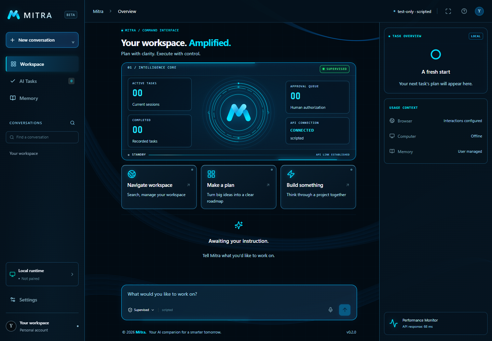

<div align="center">

# MITRA

**A supervised personal AI agent that keeps you in control.**

Bounded file tools · Explicit approvals · User-managed memory · Opt-in browser, Windows runtime & voice

<p>
  <a href="https://github.com/Amit20111/MITRA/actions/workflows/ci.yml">
    
  </a>
  
  
  
  
  
  
  
</p>

<p>
  <a href="#windows-setup">Quick Start</a> ·
  <a href="#capabilities--boundaries">Capabilities</a> ·
  <a href="#repository">Repository</a> ·
  <a href="#contracts-and-checks">Checks</a> ·
  <a href="docs/ARCHITECTURE.md">Architecture</a> ·
  <a href="PROJECT_PROGRESS.md">Roadmap</a>
</p>

</div>

---

MITRA pairs a Next.js command workspace with a FastAPI orchestrator, SQLite persistence, an optional local `llama.cpp` or hosted OpenAI-compatible model endpoint, and a separately paired Windows helper.

> [!NOTE]
> The default provider is an explicitly configured OpenAI-compatible model endpoint. MITRA does **not** start or download models automatically, and it has no production fake-provider fallback.

## Frontend screenshots

<p align="center">
  
</p>

<p align="center">
  <em>MITRA Command Workspace. Screenshot uses the deterministic test API; it does not represent live model output.</em>
</p>

The responsive frontend uses a navy-and-cyan command workspace with live application state; it does not fabricate uptime, connection status, or latency. On small screens, task overview is available from the header.

## Capabilities & boundaries

| Area | Implemented | Intentionally excluded / blocked |
| --- | --- | --- |
| **File tools** | Workspace-sandboxed `list_directory`, `read_file`, and `write_file` with exact SHA-256 argument approval and read-back verification | Generic shell tool, automatic approval bypass, workspace escapes |
| **Browser** | Opt-in read-only `inspect_page` (`MITRA_BROWSER_ORIGINS`); optional task-owned sessions (`MITRA_BROWSER_INTERACTION=true`) for exact-approved links and ordinary text fields | Form submission, authentication, password fields, uploads, downloads, arbitrary page scripts |
| **Windows runtime** | Separately launched helper (`apps/runtime`) with DPAPI-protected credentials, heartbeat, and opt-in `run --desktop` for exact-approved window inspection, capture, and focus | Arbitrary desktop typing/clicking, unauthenticated control ports, auto-start |
| **Memory** | Explicit user-authored records with revisions, provenance, global/conversation scopes, and bounded lexical retrieval (up to 3 records) | Automatic memory harvesting, silent promotion to instructions/permissions |
| **Voice** | Opt-in STT/TTS adapters (`MITRA_VOICE_ENABLED=true`), explicit recording, editable transcript review, and requested playback | Wake-word detection, background recording, automatic transcript submission |

See [browser setup and boundaries](docs/BROWSER_PHASE.md), [Windows runtime setup](docs/WINDOWS_RUNTIME.md), and [memory and voice](docs/MEMORY_AND_VOICE.md).

## Repository

```text
Frontend/             Next.js command interface with cyan accents, proxy guard, and live task indicators
apps/api/             FastAPI, Pydantic contracts, local security guard, configuration, Alembic migrations
apps/runtime/         Windows helper: encrypted pairing, opt-in observation/capture/focus
packages/contracts/   Generated TypeScript API types (do not edit)
agent/                State machine, bounded context, packaged system prompt, step-at-a-time orchestrator
models/               OpenAI-compatible streaming adapter for llama.cpp or hosted API, voice adapters
security/             Central approval policy and trace redaction
tools/                Fixed file-tool registry, path sandbox, browser adapters, subprocess dispatcher
memory/               SQLAlchemy SQLite storage and user-managed memory service
observability/        Structured logs and redacted JSONL trace export
tests/                API/policy/security/adapter tests and browser E2E
Frontend/tests/       Approval-state and event-de-duplication tests
evals/                20 scripted/live cases, runner, saved results
```

The API uses SQLite through SQLAlchemy/Alembic. Entity IDs are UUIDs; SSE uses a monotonically increasing event cursor for replay. Current work and checks are tracked in [PROJECT_PROGRESS.md](PROJECT_PROGRESS.md).

## Windows setup

Requires **Python 3.11+**, **Node.js 20.9+**, and (if using local inference) a separately installed `llama.cpp` build and GGUF model.

```powershell
git clone https://github.com/Amit20111/MITRA.git
Set-Location MITRA
python -m venv .venv
.venv\Scripts\python -m pip install -c requirements.lock -e '.[dev]'
npm ci
Copy-Item .env.example .env
```

### 1. Start the local model (optional, user-controlled)

Model startup is deferred to you. Frontend development, API startup, and scripted tests do not require a running model. Skip this step to preview the interface without inference. Development tools must not launch or download a model automatically, and live evaluations should only run when you explicitly choose to run them.

In the directory containing `llama-server.exe`, use your actual GGUF path:

```powershell
.\llama-server.exe -m "C:\Models\Qwen3.5-9B-Q4_K_M.gguf" --alias mitra-local --host 127.0.0.1 --port 8080 -ngl 0 -c 4096 --parallel 1 --jinja
```

The path is an example, not an included model. Use a `llama.cpp` build that supports your model. Keep one local model running. The backend sends `chat_template_kwargs.enable_thinking=false` by default, serializes model calls, bounds context/tool output, and limits output to 1,024 tokens. CPU latency depends on your machine; a live Qwen run has not been verified here.

Set these in root `.env`:

```dotenv
LLM_BASE_URL=http://127.0.0.1:8080/v1
LLM_MODEL=mitra-local
LLM_API_KEY=
# Optional; defaults to the repository's workspace directory:
# MITRA_WORKSPACE=C:/path/to/your/workspace
```

The API can start without a model, but requests fail honestly with a configuration/connection error. It never switches providers automatically.

### 2. Start the API

```powershell
.venv\Scripts\python -m apps.api.migrate
.venv\Scripts\python -m uvicorn apps.api.main:app --host 127.0.0.1 --port 8000 --workers 1 --no-access-log
```

Startup also applies Alembic migrations. SQLite uses `.data/mitra-slice1.db`. Previous milestone databases (`mitra.db`, test databases) are preserved and not automatically imported. Run one API worker; this is a local, single-user service, not an authenticated public deployment.

### 3. Start the frontend

In another terminal:

```powershell
npm run dev
```

Open **http://127.0.0.1:3000**. API docs: **http://127.0.0.1:8000/docs**. Frontend requests proxy `/api/v1/*` to the API. A custom `MITRA_API_URL` belongs in the frontend shell or `Frontend/.env.local`, not root `.env`.

Try: `Read notes.txt in the workspace and summarize it.` Then ask to create a file. A write creates a pending approval containing the exact target/content. Approving permits execution; rejection never dispatches that write. Successful writes show `verified` after hash read-back. Earlier completed steps are not undone by cancelling a task.

## Optional Windows runtime

Settings can pair and revoke the separate Windows helper. See [runtime setup and boundaries](docs/WINDOWS_RUNTIME.md). Pairing alone supports heartbeat; `run --desktop` opts into exact-approved window inspection, capture, and focus. No model is required, and nothing starts automatically.

## Memory and voice

The Memory screen saves explicit confirmed facts, supports editing/deletion, and retrieves bounded relevant records per task. The microphone control supports opt-in recording, transcript review, and playback through explicitly configured speech providers. Voice is disabled by default and never starts a model. See [memory/voice setup and limits](docs/MEMORY_AND_VOICE.md).

## Provider roles and hosted comparison

`agent`, `summarizer`, `embedder`, `stt`, and `tts` accept `LLM_<ROLE>_PROVIDER`, `BASE_URL`, `MODEL`, and `API_KEY`. General roles inherit agent configuration, but speech additionally requires explicit STT/TTS URLs, model names, and `MITRA_VOICE_ENABLED=true`. Summarizer/embedder remain configuration-only. Settings displays public configuration, never keys.

For a compatible hosted endpoint, explicitly set `LLM_AGENT_PROVIDER=hosted`, its HTTPS `LLM_AGENT_BASE_URL`, model, and key in root `.env`, then restart the API. Hosted operation and local inference have not been live-tested; HTTP adapter behavior is tested with mocked transport.

## Contracts and checks

```powershell
npm run gen:types              # Generate from app.openapi(), no server needed
npm run gen:types:live         # Generate from running API /openapi.json
npm run check:types            # Fails on stale generated types
npm run lint
npm run typecheck
npm test
npm run build
.venv\Scripts\python -m ruff check apps/api apps/runtime agent models tools memory security observability tests evals
.venv\Scripts\python -m mypy
.venv\Scripts\python -m pytest -q
npm run test:e2e
```

Browser tests use the installed Edge browser on Windows; on Linux run `npx playwright install chromium` first. They launch test-only servers on **3007/8007**, a separate `.next-e2e` build directory, and a temporary workspace. Your normal servers and files are not reused. No test provider can be selected through production environment configuration.

`.github/workflows/ci.yml` checks generated types, lint, types, backend tests, frontend tests, build, browser E2E, and scripted evals. `requirements.lock` pins the verified Python environment. Root npm commands continue to work.

## Evaluations and traces

```powershell
.venv\Scripts\python -m evals.run --provider fake
.venv\Scripts\python -m evals.run --provider local --timeout 300
.venv\Scripts\python -m observability.export --output .data/traces-export.jsonl
```

The exporter refuses to overwrite an existing file and re-applies redaction. Traces include model request messages, schemas, raw responses, normalized proposals, validation errors, approval state, latency, usage, outcome, and verification. Interrupted generations are recorded as incomplete. Exports can contain personal content even after credential redaction; keep them local unless you intend to share them.

The runner creates temporary workspaces and executes the real orchestration/API/tool stack. It auto-approves **only the exact write expected by the fixture**, and denies unexpected proposals. Saved results are in `evals/results/`. Scripted scores verify infrastructure, not real-model reasoning or injection resistance. Missing model configuration is recorded as `not_run`, not a passing score.

## Documentation

- [Architecture & limitations](docs/ARCHITECTURE.md)
- [API & SSE event contract](docs/API_CONTRACT.md)
- [Browser setup & boundaries](docs/BROWSER_PHASE.md)
- [Windows runtime setup](docs/WINDOWS_RUNTIME.md)
- [Memory & voice](docs/MEMORY_AND_VOICE.md)
- [Slice 1 implementation report](docs/SLICE1_REPORT.md)
