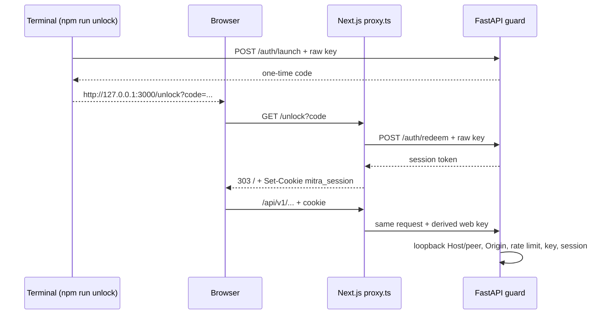

# Local security boundary (milestone 8A)

MITRA is a single-user, loopback-only application. 8A adds authentication and request hardening so that **other websites, other Windows accounts on the same PC, and unauthenticated browser tabs** cannot read or control it. It does not defend against hostile programs that already run under your Windows account; those can read your profile, including the key file.

## Components

| Piece | Location | Role |
| --- | --- | --- |
| Local key | `%LOCALAPPDATA%\MITRA\local-api.key` (`MITRA_SECRET_DIR` overrides) | 256-bit random value, created by the API on first start. It is published atomically by a hard link from a temporary file, so it is never partial. Windows ACL inheritance is removed and only the current user's SID is granted access (POSIX: `0600`). Malformed keys stop startup. |
| Derived web key | `HMAC-SHA256(key, "mitra-web-v1")` | Attached by the Next.js proxy to forwarded browser requests. The raw key is never forwarded. |
| Launch codes | API memory | `POST /api/v1/auth/launch` (raw key only, no browser `Origin`). Single use, valid for 120 s, at most five pending, stored as SHA-256 hashes. |
| Sessions | SQLite `auth_sessions` (migration `0004`) | Only SHA-256 token hashes are stored. Absolute expiry defaults to 168 h (`MITRA_SESSION_HOURS`, 1–720). They survive API restarts. Logout deletes the current row; revoke-all deletes every row and pending launch code. Open SSE streams recheck the session about every 5 s. |
| Cookie | `mitra_session` | `HttpOnly; SameSite=Strict; Path=/`, with expiry equal to the session's. `Secure` is not set because the app runs on plain `http://127.0.0.1`. |

## Request flow

## API guard (`apps/api/security_guard.py`)

1. **Loopback peer and Host on every path.** This blocks DNS rebinding, because a rebound domain's Host header is refused.
2. **Origin allowlist** (`MITRA_WEB_ORIGIN` plus `localhost`/`127.0.0.1:3000`). Native runtime routes and control-plane routes refuse any browser `Origin`.
3. **Global rate limits per minute.** Auth: 20. Pairing claim: 20. Native helper: 1200. Messages: 30. Voice: 30. Other writes: 300. Responses are `429` with `Retry-After`; reads are not limited.
4. **Authentication:**
   - Native helper routes (claim, heartbeat, disconnect, poll, authorize, result) keep their own pairing and runtime credentials.
   - `/api/v1/auth/launch`, `/api/v1/auth/redeem` and `/openapi.json` require the raw key and reject requests that carry the web key, which means they came through the proxy.
   - Every other `/api/` route requires the web or raw key **and** a valid session cookie.
5. All `/api/` responses carry `no-store`, `nosniff`, `X-Frame-Options: DENY`, `Referrer-Policy: no-referrer` and `CORP: same-origin`. `/docs` and `/redoc` are disabled.
6. The redactor also masks the local key and the web key in traces.

## Next.js proxy (`Frontend/proxy.ts`) and headers

- Returns `421` for non-loopback Host headers.
- `/api/*`: refuses cross-site `Sec-Fetch-Site` values, and refuses state-changing requests whose `Origin` is not same-origin. It returns 404 for the control-plane routes. It strips any client-supplied `x-mitra-local-key` and adds the web key. There is no fallback rewrite in `next.config.mjs`, so if the proxy is bypassed, requests arrive without credentials and fail.
- `/unlock` redeems the code server-side and sets the cookie. It refuses cross-site navigations.
- Page requests are checked against `/api/v1/auth/session`. Missing or invalid sessions get the `/locked` screen and the cookie is cleared. If the API is offline, the shell still loads but shows no data.
- `next.config.mjs` sets these headers: CSP (`default-src 'self'`, `connect-src 'self'`, `object-src 'none'`, `frame-ancestors 'none'`, `base-uri 'none'`, `form-action 'self'`; `'unsafe-eval'` only in development); `X-Frame-Options: DENY`; `nosniff`; `no-referrer`; COOP/CORP `same-origin`; and a restrictive `Permissions-Policy` (microphone and fullscreen for self only).

## Limitations

- `script-src` still allows `'unsafe-inline'`. Nonce or hash CSP would require dynamic rendering or experimental SRI, so it is deferred. `connect-src 'self'` limits where injected script could send data.
- Same-user malware, administrators and SYSTEM can read the key. DPAPI wrapping for the Node side would need a native module (planned for the Tauri shell).
- Rate limits are global and in memory, and reset on restart. That is enough for a single local user, but they are not per-client controls.
- The launch link appears in browser history until it is used or expires.
- Plain HTTP on loopback is not encrypted. Other local processes that can sniff loopback traffic (which needs elevated rights) could observe cookies.
